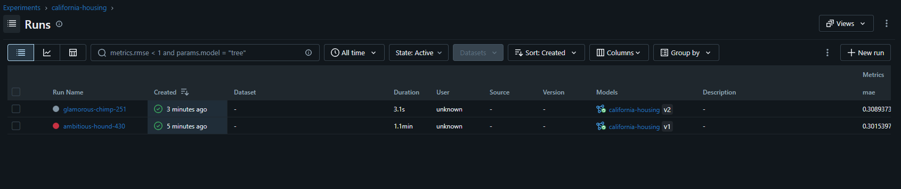
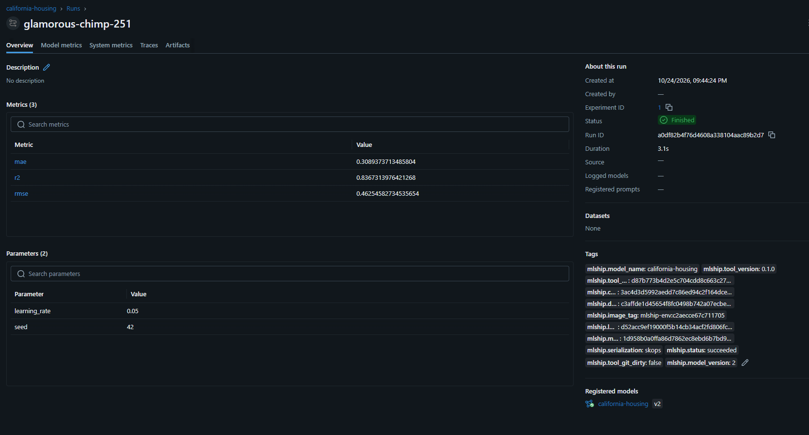
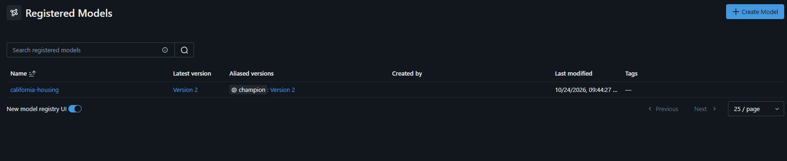
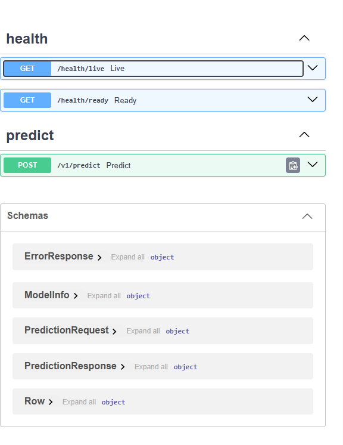
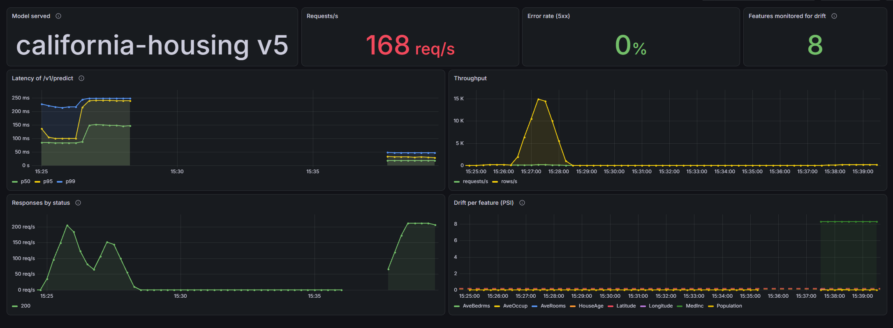
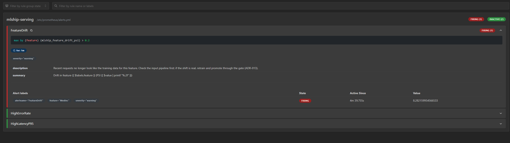

# mlship 🚢

Do `train.py` à API REST, sem escrever servidor, Dockerfile nem pipeline. O cientista entrega **só código
Python**; o `mlship` treina em container isolado, registra no MLflow e serve o modelo com FastAPI.


## Sumário

- [Sobre 🔎](#sobre-)
- [Como funciona](#como-funciona)
- [Requisitos](#requisitos)
- [Quickstart: um comando](#quickstart-um-comando)
- [Passo a passo: do zero à primeira predição](#passo-a-passo-do-zero-à-primeira-predição)
- [Use com o seu modelo](#use-com-o-seu-modelo)
- [API 📍](#api-)
- [Monitoramento e alertas](#monitoramento-e-alertas)
- [Teste de carga](#teste-de-carga)
- [Segurança e isolamento](#segurança-e-isolamento)
- [Configuração](#configuração)
- [Problemas comuns](#problemas-comuns)
- [Desenvolvimento e testes](#desenvolvimento-e-testes)
- [Documentação do projeto](#documentação-do-projeto)

## Sobre 🔎

Este projeto responde a um desafio de MLOps: **levar modelos de ML do treino reprodutível e isolado até uma
API REST**, com o contrato mais enxuto possível para quem treina.

O cientista escreve duas coisas:

| Arquivo | O que é |
| --- | --- |
| `train.py` | Uma função `train(data_dir, params)` que devolve o modelo, as métricas e um exemplo de entrada |
| `requirements.txt` | As bibliotecas que o treino usa |

O resto é da plataforma: ambiente reprodutível, isolamento, rastreio, registro, API, métricas e alertas.

### Implementado ✅

- [x] CLI com seis comandos: `init`, `validate`, `train`, `runs`, `promote`, `serve` (e `lock`)
- [x] Validação do projeto **sem executar o código**, com todos os problemas de uma vez
- [x] Ambiente reprodutível: dependências travadas com hashes, uma imagem por lock, a mesma no treino e no serving
- [x] Treino em container sem rede, sem credenciais e com limites
- [x] Manifesto de cada run: hashes de código, dados, dependências, ambiente e modelo
- [x] Registro no MLflow com alias explícito (`champion`), nunca "a última versão"
- [x] Promoção rastreável: o `promote` registra no MLflow quem promoveu, quando e qual versão foi substituída
- [x] API FastAPI com documentação OpenAPI, validação de todos os campos e predição vetorizada
- [x] Métricas Prometheus, dashboard Grafana, detecção de drift (PSI) e três alertas
- [x] Teste de carga com Locust e resultados medidos
- [x] CI: lint, testes unitários, integração e ponta a ponta com Docker, gitleaks, Trivy e Dependabot

### Fora do código, só no desenho 🔮

Gate de promoção (comparar champion e candidato antes de mover o alias), arquitetura de produção na AWS,
ambientes dev/QA/prod, feature store, inferência em lote como job, canary e shadow. Veja [docs/architecture](docs/architecture/README.md). O que faríamos com mais tempo está em
[DECISIONS.md](DECISIONS.md#com-mais-tempo).

## Como funciona

```text
 train.py + requirements.txt
            │
   mlship validate ──► lê o código sem executá-lo e lista TODOS os problemas
            │
   mlship train ─────► treina num container sem rede ──► host confere os hashes ──► MLflow
            │
   mlship runs ──────► runs, versões e métricas
            │
   mlship promote ───► alias `champion` aponta para a versão aprovada
            │
   mlship serve ─────► API em http://127.0.0.1:8080 (docs, métricas, health)
```

| Comando | Para que serve |
| --- | --- |
| `mlship init <pasta>` | Cria um projeto que já valida e treina, para você trocar pelo seu modelo |
| `mlship validate <pasta>` | Confere `train.py`, `requirements.txt` e dados, sem executar nada |
| `mlship lock <pasta>` | Trava as dependências com hashes (`mlship.lock`) |
| `mlship train <pasta> --data <dados>` | Valida, constrói o ambiente e treina em container isolado |
| `mlship runs <pasta>` | Lista os runs, do mais novo ao mais antigo |
| `mlship promote <versão>` | Move um alias (padrão `champion`) para a versão escolhida |
| `mlship serve` | Resolve o alias, confere o hash do modelo, constrói a imagem e sobe a API |

Cada comando tem `--help`. A visão completa de componentes, na versão local e na AWS, está em
[docs/architecture](docs/architecture/README.md).

## Requisitos

| Ferramenta | Para quê |
| --- | --- |
| [uv](https://docs.astral.sh/uv/) | Instala o projeto e roda a CLI |
| Docker em execução | Treino, serving, MLflow, Prometheus e Grafana |
| Alguns GB livres em disco | Imagens do ambiente (no Windows, no disco do Docker Desktop) |

O Docker precisa estar aberto antes do `train` e do `serve`. Os passos abaixo funcionam em Linux, macOS e
Windows (PowerShell); onde o comando muda, os dois aparecem.

## Quickstart: um comando

Para ver tudo funcionando sem seguir os passos um a um (com Docker aberto):

```bash
git clone https://github.com/issitarual/mlops-platform-challenge
cd mlops-platform-challenge
uv run scripts/quickstart.py
```

O script roda, na ordem, os passos 1 a 8 abaixo: instala o projeto, sobe o MLflow, baixa os dados, treina o
exemplo, **promove a versão que acabou de treinar** e sobe a API. Ele imprime o `curl` para você chamar de
outro terminal. Ctrl+C para a API. Para parar antes de subir a API, use `--no-serve`.

É o mesmo caminho do passo a passo, só encadeado; quer entender ou adaptar cada etapa, siga a seção abaixo.
Funciona em Linux, macOS e Windows, porque é um script Python (sem `.sh` e `.ps1` separados).

## Passo a passo: do zero à primeira predição

Vamos treinar o exemplo **California Housing** (regressão do preço de imóveis) e servir o modelo.

### 1. Clone e instale

```bash
git clone https://github.com/issitarual/mlops-platform-challenge
cd mlops-platform-challenge
uv sync --all-packages
uv run mlship --help
```

O último comando lista os comandos da CLI. Se ele funcionou, a instalação está pronta.

### 2. Suba o MLflow

```bash
docker compose up -d
```

O MLflow (rastreio e registry) fica em http://127.0.0.1:5000. Ele guarda runs e modelos num volume do Docker.
Se esquecer deste passo, a CLI avisa antes de construir ou treinar qualquer coisa.

### 3. Baixe os dados do exemplo

```bash
uv run scripts/download_california_housing.py
```

O container de treino não tem rede, então os dados são baixados aqui, no seu computador. O script confere o
SHA-256 do arquivo antes de gravá-lo. Os dados **não** ficam no repositório: a fonte não declara licença
([origem](https://www.dcc.fc.up.pt/~ltorgo/Regression/cal_housing.html)), então só guardamos o script e o hash
(ADR-010).

### 4. Valide o projeto

```bash
uv run mlship validate examples/california-housing --data examples/california-housing/data
```

Mostra **todos** os problemas de uma vez, cada um com o local e como corrigir. Erros bloqueiam; avisos não.

### 5. Treine

```bash
uv run mlship train examples/california-housing --data examples/california-housing/data
```

Na primeira vez a ferramenta resolve as dependências e constrói a imagem do ambiente, então demora mais; nas
seguintes ela reaproveita as duas. O treino roda num container sem rede, com sistema de arquivos somente
leitura e com limites. O resultado fica em `examples/california-housing/.mlship/runs/<run_id>/`, com o
`manifest.json`.

Para mudar parâmetros, use `-p` (pode repetir):

```bash
uv run mlship train examples/california-housing --data examples/california-housing/data -p seed=7 -p learning_rate=0.05
```

Cada treino com sucesso vira uma **nova versão** do modelo `california-housing` (o nome da pasta; `--model-name`
muda).

### 6. Veja os runs

```bash
uv run mlship runs examples/california-housing
```

O mesmo está no MLflow, em http://127.0.0.1:5000. Cada run guarda métricas, parâmetros e tags de rastreio
(hash do código, dos dados, do ambiente e do modelo):





### 7. Promova uma versão

```bash
uv run mlship promote 1 --project examples/california-housing
```

Isso aponta o alias `champion` para a versão 1 e registra no MLflow quem promoveu, quando e qual versão foi
substituída. O serving sempre segue um alias explícito, nunca "a última versão", então ninguém serve um modelo
sem querer. Hoje o `promote` **não compara métricas** entre versões; o gate está descrito no ADR-013, mas não
implementado.



### 8. Suba a API

```bash
uv run mlship serve --project examples/california-housing
```

O `serve` resolve o alias, baixa o modelo, **confere o SHA-256** com o registrado, monta a imagem de serving
sobre a imagem exata do treino e sobe a API. Você verá algo assim:

```text
champion → california-housing v1 (run 0a1b2c3d4e5f, sha256 1d958b0a0ffa… verified)
Environment mlship-env:... (reused)
Serving image ...

Ready: docs http://127.0.0.1:8080/docs  ·  metrics http://127.0.0.1:8080/metrics
Predict: POST http://127.0.0.1:8080/v1/predict
Press Ctrl+C to stop.
```

(Os identificadores acima são ilustrativos.) Ctrl+C para a API e remove o container. Opções: `--alias`,
`--port`, `--workers` (padrão 1).

### 9. Faça uma predição

Em **outro terminal**:

```bash
curl -s http://127.0.0.1:8080/v1/predict -H "content-type: application/json" -d '{
  "rows": [{"MedInc": 8.3, "HouseAge": 41.0, "AveRooms": 6.98, "AveBedrms": 1.02,
            "Population": 322.0, "AveOccup": 2.56, "Latitude": 37.88, "Longitude": -122.23}]
}'
```

No PowerShell:

```powershell
Invoke-RestMethod -Uri http://127.0.0.1:8080/v1/predict -Method Post -ContentType "application/json" -Body '{"rows": [{"MedInc": 8.3, "HouseAge": 41.0, "AveRooms": 6.98, "AveBedrms": 1.02, "Population": 322.0, "AveOccup": 2.56, "Latitude": 37.88, "Longitude": -122.23}]}'
```

A resposta traz uma predição por linha, o modelo e a versão que respondeu, e um `request_id` para rastrear
a chamada nos logs:

```json
{
  "model": {"name": "california-housing", "version": "1"},
  "predictions": [4.2],
  "request_id": "..."
}
```

(Valores ilustrativos.)

### 10. Explore a documentação interativa

Abra http://127.0.0.1:8080/docs. A documentação OpenAPI é gerada **a partir do exemplo de entrada do seu
modelo**, com os nomes e tipos de cada coluna, e você pode testar a API pelo navegador.



### 11. Monitore (opcional)

Com a API no ar, em outro terminal:

```bash
docker compose --profile monitoring up -d
```

Abra o dashboard em http://127.0.0.1:3000. Detalhes na seção [Monitoramento e alertas](#monitoramento-e-alertas).

### 12. Pare tudo

Ctrl+C no terminal do `serve`. Para parar o MLflow e o monitoramento:

```bash
docker compose --profile monitoring down
```

Os runs e modelos continuam no volume do Docker. Para apagá-los também, acrescente `-v`.

## Use com o seu modelo

### Crie o projeto

```bash
uv run mlship init meu-modelo
```

Cria `train.py`, `requirements.txt`, dados de exemplo e o `mlship.lock`. O projeto criado passa na validação e
treina como está: troque o modelo e os dados pelos seus e rode `validate` e `train` de novo.

### O contrato

Só `train.py` e `requirements.txt`. A função `train` recebe a pasta de dados e os parâmetros e devolve um
`TrainOutput`:

```python
from pathlib import Path

from mlship_sdk import TrainOutput


def train(data_dir: Path, params: dict) -> TrainOutput:
    ...
    return TrainOutput(
        model=pipeline,  # qualquer objeto com .predict(); pré-processamento dentro dele
        metrics={"rmse": rmse},  # números finitos
        input_example=x_test.head(5),  # gera o schema da API e o smoke test
        reference_data=x_train,  # opcional: baseline para detectar drift no serving
    )
```

| Campo | Obrigatório | Para quê |
| --- | --- | --- |
| `model` | sim | Precisa ter `.predict()`. O pré-processamento deve estar dentro do modelo (pipeline), para o serving receber os dados crus |
| `metrics` | sim | Métricas numéricas e finitas, registradas no run |
| `input_example` | sim | Gera o schema da API e roda um teste de fumaça do modelo depois do treino |
| `reference_data` | não | Distribuição de treino usada para detectar drift em produção |

O `params` sempre inclui `seed`, e a ferramenta fixa as seeds globais (`random`, `numpy`, `PYTHONHASHSEED`).

### Validar antes de treinar

```bash
uv run mlship validate meu-modelo --data meu-modelo/data
```

O `validate` lê o código **sem executá-lo** e mostra tudo de uma vez:

| Nível | Exemplos |
| --- | --- |
| **Erro** (bloqueia) | `train.py` ausente ou com sintaxe inválida, função `train` ausente ou com assinatura errada, opções proibidas no `requirements.txt` (`--index-url`, `git+`, `-e`, URLs, caminhos locais), pacote que não resolve, pins incompatíveis com o runtime, pasta de dados vazia ou com formato não suportado |
| **Aviso** (não bloqueia) | Versão não fixada, import sem pacote declarado, acesso à rede, caminho absoluto, segredo lido do ambiente, código pesado no módulo |

Opções úteis:

```bash
uv run mlship validate meu-modelo --strict              # avisos viram erro
uv run mlship validate meu-modelo --format json         # para CI: saída 0 válido, 1 bloqueado
uv run mlship validate meu-modelo --offline             # não resolve dependências (sem rede)
```

### Dependências e lock

Depois de mudar o `requirements.txt`:

```bash
uv run mlship lock meu-modelo
```

Isso atualiza o `mlship.lock`, que trava cada dependência com hash. **Commite os dois arquivos.** A instalação usa
`--require-hashes` e só aceita wheels por padrão.

### Modelos que não são do scikit-learn

Por padrão, a ferramenta só aceita estimadores do scikit-learn. Para outros tipos de modelo, use
`--allow-pickle` no `train`. Atenção: carregar um modelo salvo com pickle pode executar código arbitrário; a
escolha fica registrada no run (ADR-017). O `serve` só carrega pickle de um run treinado com essa flag, e o
treino sem a flag recusa um modelo que não seja `skops`.

```bash
uv run mlship train meu-modelo --data meu-modelo/data --allow-pickle
```

## API 📍

Depois do `mlship serve`:

| Rota | O que faz |
| --- | --- |
| <kbd>POST /v1/predict</kbd> | Recebe uma ou mais linhas (até 1000) e devolve uma predição por linha |
| <kbd>GET /health/live</kbd> | A API está viva? |
| <kbd>GET /health/ready</kbd> | O modelo está carregado e pronto? |
| <kbd>GET /metrics</kbd> | Métricas no formato Prometheus |
| <kbd>GET /docs</kbd> | Documentação interativa (OpenAPI) |

O modelo é carregado **uma vez**, na subida, e a versão fica fixada naquela instância: trocar de modelo é
fazer novo `serve`. A resposta e os logs sempre informam a versão.

**Erros.** A API valida o payload inteiro e devolve **todos** os erros de campo de uma vez, sem stack trace.

| Código | Quando |
| --- | --- |
| 401 | Header `X-API-Key` ausente ou inválido (só com API key ativa) |
| 413 | Payload maior que 1 MB |
| 422 | Campos inválidos ou mais de 1000 linhas |
| 503 | Modelo ainda não carregado |
| 504 | Predição passou de 10 s |

**API key (opcional).** Defina `MLSHIP_SERVING_API_KEY` antes do `serve`; as chamadas a `/v1/*` passam a exigir o
header `X-API-Key`.

**Em segundo plano.** A imagem de serving é autossuficiente:
`docker run -d -p 127.0.0.1:8080:8080 <imagem mostrada pelo serve>`.

## Monitoramento e alertas

```bash
docker compose --profile monitoring up -d
```

| Serviço | Endereço | Observação |
| --- | --- | --- |
| Grafana | http://127.0.0.1:3000 | Só leitura, sem login; o dashboard abre como página inicial |
| Prometheus | http://127.0.0.1:9090 | Alertas em http://127.0.0.1:9090/alerts |

Com o perfil no ar, o `serve` mostra o endereço do dashboard, e **cada API iniciada entra na coleta
automaticamente**, em qualquer porta.

### Dashboard



| Painel | O que mostra |
| --- | --- |
| Model served | Nome e versão do modelo em serving |
| Requests/s e Error rate (5xx) | Tráfego e taxa de erros do servidor |
| Latency of /v1/predict | p50, p95 e p99, com a linha do limite de 500 ms |
| Throughput | Requisições e linhas preditas por segundo |
| Responses by status | Respostas por código HTTP |
| Features monitored for drift | Quantas features têm baseline |
| Drift per feature (PSI) | Índice de estabilidade da população de cada feature |

### Drift

Se o treino passou `reference_data`, a API compara as **últimas 1000 linhas recebidas** com a distribuição do
treino, feature por feature, usando o PSI. O cálculo só começa depois de 200 linhas. Uma regra prática: PSI
abaixo de 0,1 é estável, e **acima de 0,2 indica mudança relevante**.

### Alertas

| Alerta | Dispara quando | Severidade |
| --- | --- | --- |
| `FeatureDrift` | PSI de uma feature acima de 0,2 por 1 minuto | warning |
| `HighErrorRate` | Mais de 1% das predições com erro 5xx por 5 minutos | critical |
| `HighLatencyP95` | p95 acima de 500 ms por 5 minutos | warning |

Veja um `FeatureDrift` disparando para a feature `MedInc`, depois de enviar dados deslocados:



Localmente os alertas são **exibidos**, não enviados. Na arquitetura de produção, eles acionam o fluxo de retreino, que passa de
novo por um gate de promoção (veja [docs/architecture](docs/architecture/README.md)).

### Provoque um drift para ver o alerta

Com a API no ar e o monitoramento ligado:

```bash
uv run python loadtest/run.py --scenario drift --users 5 --duration 120s
```

O cenário envia linhas com uma feature deslocada. Em poucos minutos o `FeatureDrift` aparece em
http://127.0.0.1:9090/alerts.

## Teste de carga

Com o modelo servido (`mlship serve`), em outro terminal:

```bash
uv run python loadtest/run.py --scenario single --users 20 --duration 60s --label "2 workers"
uv run python loadtest/run.py --scenario batch --users 20 --duration 60s --label "2 workers"   # 100 linhas por requisição
uv run python loadtest/run.py --scenario drift --users 5 --duration 120s                       # faz o alerta de drift disparar
```

O script roda o Locust sem interface e imprime a linha da tabela abaixo. No CI, o teste ponta a ponta roda um
smoke de 15 s que falha com qualquer erro ou p95 acima de 500 ms.

Resultados com `serve --workers 1` e `--workers 2` (indicado no cenário). O container da API tem limite de 2 CPUs
e 2 GB, e a máquina é de 28 CPUs:

| Scenario | Users | Requests | Req/s | p50 ms | p95 ms | p99 ms | Failures | Machine |
| --- | --- | --- | --- | --- | --- | --- | --- | --- |
| single (1 worker) | 20 | 13070 | 220.6 | 89 | 120 | 140 | 0 | Windows AMD64, 28 CPUs |
| batch (1 worker) | 20 | 9654 | 163.0 | 120 | 170 | 190 | 0 | Windows AMD64, 28 CPUs |
| single (2 workers) | 20 | 19774 | 334.8 | 60 | 72 | 84 | 0 | Windows AMD64, 28 CPUs |
| batch (2 workers) | 20 | 17659 | 298.6 | 65 | 99 | 120 | 0 | Windows AMD64, 28 CPUs |

Servidor e Locust na mesma máquina disputam CPU, então os números são um piso, não a capacidade de uma instância
dedicada. Cada predição usa uma thread nativa (ADR-020 explica por que, com a medição).

## Segurança e isolamento

O código do cientista e tudo que ele produz são tratados como **não confiáveis**.

| Camada | O que a ferramenta faz |
| --- | --- |
| Validação | Lê o código por análise estática, sem executá-lo |
| Instalação das dependências | Única etapa com rede; `--require-hashes`, só wheels por padrão, sem credenciais |
| Container de treino | Sem rede, usuário não-root, sistema de arquivos somente leitura, `/tmp` em memória, sem capabilities, sem novos privilégios; limites de 2 CPUs, 4 GB, 256 processos e 1 hora |
| Saída do treino | Só `/output` é gravável; o **host** recalcula os hashes e é quem registra no MLflow |
| Modelo | O container de treino não tem o endereço do MLflow nem credenciais; o hash é conferido antes de qualquer `load` |
| Container de serving | Não-root, somente leitura, sem credenciais e sem acesso ao MLflow; limites de 2 CPUs e 2 GB. **Tem saída de rede localmente**; em produção o egress é fechado por security groups |
| API | Schema validado, limites de payload (1 MB) e de linhas (1000), timeout de 10 s, erros sem stack trace |
| CI | gitleaks, Trivy nas dependências e nas imagens, Dependabot |

Os limites e as alternativas descartadas estão em [DECISIONS.md](DECISIONS.md) (ADR-005, 017, 018, 019 e 020).

## Configuração

A CLI lê variáveis de ambiente com o prefixo `MLSHIP_`; a API de serving, com `MLSHIP_SERVING_`.

| Variável | Padrão | Para quê |
| --- | --- | --- |
| `MLSHIP_TRACKING_URI` | `http://127.0.0.1:5000` | Endereço do MLflow |
| `MLSHIP_MODEL_NAME` | nome da pasta do projeto | Nome do modelo registrado |
| `MLSHIP_SERVING_API_KEY` | desligada | Exige o header `X-API-Key` nas rotas `/v1/*` |

PowerShell: `$env:MLSHIP_TRACKING_URI = "http://127.0.0.1:5000"`. Os demais ajustes (limites de CPU e memória,
tempo máximo do treino, tamanho da janela de drift) estão em `packages/cli/src/mlship/config.py` e
`packages/runtime/src/mlship_runtime/serving/core/config.py`. Não há nenhum segredo no repositório.

## Problemas comuns

| Sintoma | Causa provável | O que fazer |
| --- | --- | --- |
| `port is already allocated` no `serve` | Outra API já está rodando nessa porta, geralmente de um `serve` anterior | Ctrl+C no outro terminal, ou `mlship serve --port 8081` |
| A CLI avisa que não alcança o MLflow | O MLflow não está no ar | `docker compose up -d` |
| Erro de Docker no `train` ou no `serve` | O Docker não está aberto | Abra o Docker Desktop e tente de novo |
| Treino falha por falta de espaço | Imagens ocupam alguns GB | Libere disco (no Windows, o do Docker Desktop) |
| Painéis do Grafana com "No data" | A API está parada ou não recebeu tráfego | Suba o `serve` e envie requisições; os painéis voltam sozinhos |
| Painel de drift vazio | O treino não passou `reference_data`, ou a API recebeu menos de 200 linhas | Passe `reference_data` no `TrainOutput` e envie mais linhas |
| Dashboard não refletiu uma mudança | O Grafana guarda o painel provisionado | Recarregue a página (F5) ou reinicie o Grafana |
| `validate` bloqueia por lock ausente ou desatualizado | O `requirements.txt` mudou | `mlship lock <pasta>` e commite o `mlship.lock` |

## Desenvolvimento e testes

```bash
uv sync --all-packages      # instala os 3 pacotes do workspace e as ferramentas de dev
uv run pytest tests/unit    # segundos, sem rede nem Docker
```

Com Docker e o MLflow no ar (`docker compose up -d`), os testes de integração e o ponta a ponta pela CLI
(`init` → `validate` → `train` → `promote` → `serve` → `predict`):

```bash
export MLSHIP_TRACKING_URI=http://127.0.0.1:5000      # PowerShell: $env:MLSHIP_TRACKING_URI = "http://127.0.0.1:5000"
uv run pytest -m "integration or e2e" tests/integration tests/e2e -v
```

O CI roda também os testes do runtime com as versões mínimas declaradas, o gitleaks no histórico e o Trivy nas
dependências e nas imagens (ADR-022).

| Pacote | Onde roda | Papel |
| --- | --- | --- |
| `packages/sdk` (`mlship_sdk`) | código do cientista | contrato `TrainOutput`, sem dependências |
| `packages/runtime` (`mlship_runtime`) | dentro da imagem | runner de treino e API de serving |
| `packages/cli` (`mlship`) | máquina do usuário | CLI `init`, `validate`, `lock`, `train`, `runs`, `promote`, `serve` |

## Documentação do projeto

| Documento | Conteúdo |
| --- | --- |
| [DECISIONS.md](DECISIONS.md) | Cada decisão com contexto, alternativas descartadas e consequências; fora de escopo; o que faríamos com mais tempo; tempo gasto |
| [docs/architecture](docs/architecture/README.md) | Arquitetura hoje, com mais tempo e em produção na AWS |
| [AI_USAGE.md](AI_USAGE.md) | Como a IA foi usada, o que funcionou e o que foi corrigido ou rejeitado |
| [examples/california-housing](examples/california-housing/README.md) | O projeto de exemplo |

Licença: [MIT](LICENSE). O dataset California Housing não é redistribuído aqui (ver ADR-010).
