# Arquitetura

Três visões do mesmo sistema, da mais concreta para a mais ampla:

1. [**Hoje**](#1-hoje-o-que-está-implementado): o que existe no repositório e roda com `docker compose`.
2. [**Com mais tempo**](#2-com-mais-tempo): a mesma ferramenta, com o backlog de [DECISIONS.md](../../DECISIONS.md#com-mais-tempo) incorporado.
3. [**Produção na AWS**](#3-produção-na-aws): o desenho de referência, com um par AWS para cada componente local.

Tudo que aparece em **1** está implementado e testado; **2** e **3** são desenho, sem implementação (ver [Fora de escopo](../../DECISIONS.md#fora-de-escopo)).

## Princípios que valem nas três visões

| Princípio | Onde está |
| --- | --- |
| O código do cientista e tudo que ele produz são não confiáveis | ADR-018, ADR-017 |
| Âncora de confiança: o banco do MLflow (tags e registry), não o armazenamento de artefatos | ADR-019, ADR-020 |
| Treino sem rede, sem credenciais e sem acesso ao registry; o host confere os hashes e registra | ADR-018, ADR-019 |
| Uma imagem de ambiente por hash do lock, igual no treino e no serving | ADR-005 |
| Serving imutável: imagem por versão de modelo, alias resolvido no deploy | ADR-007, ADR-020 |
| Contrato mínimo: `train.py` + `requirements.txt`, o resto é da plataforma | ADR-002 |

---

## 1. Hoje: o que está implementado

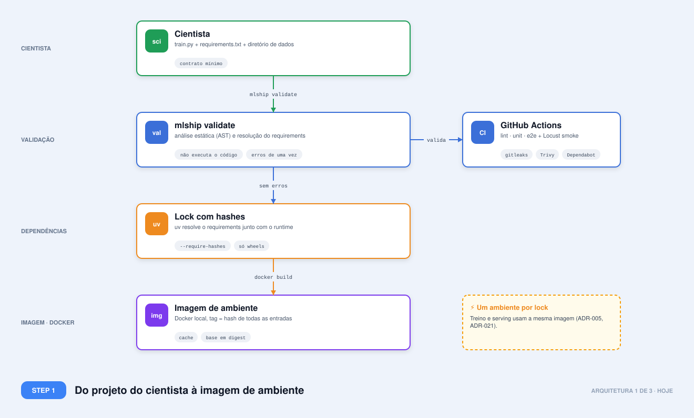

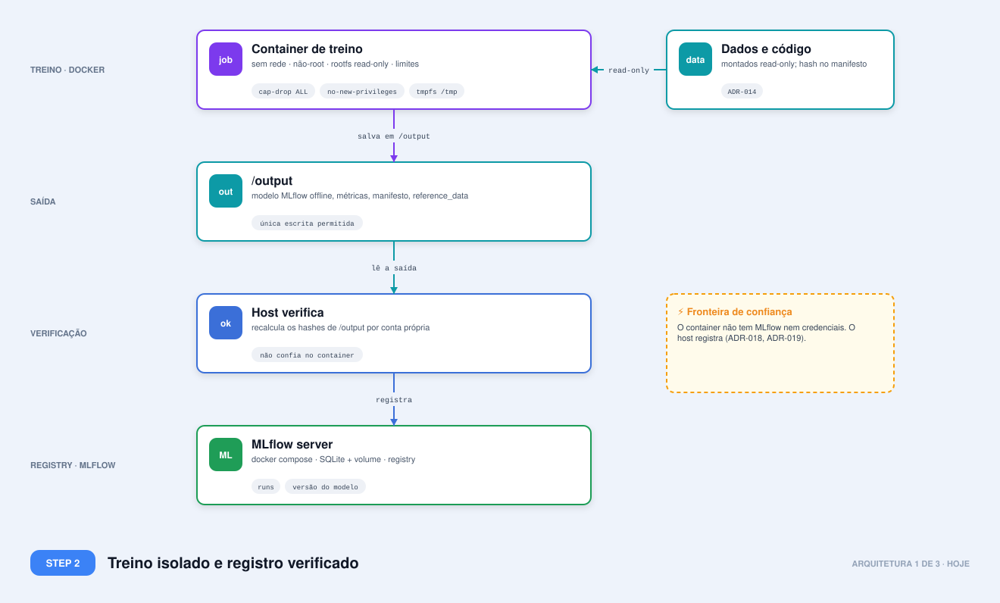

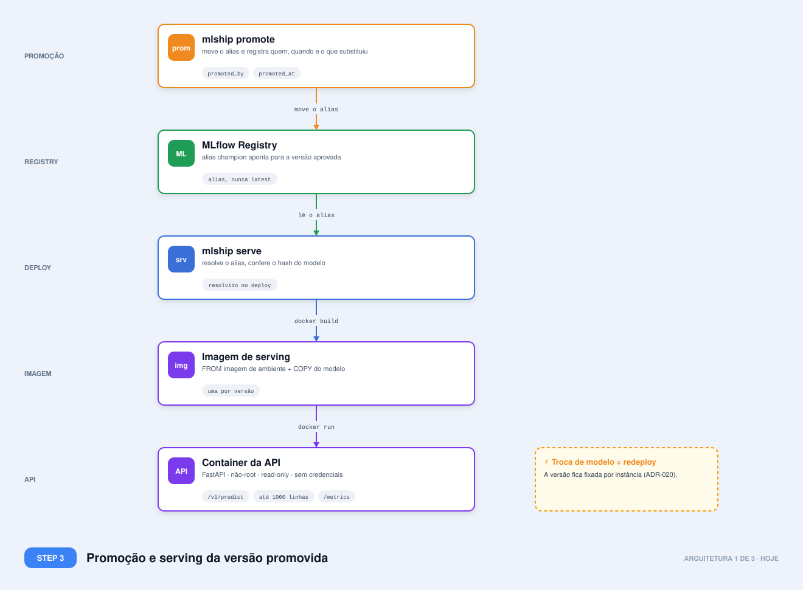

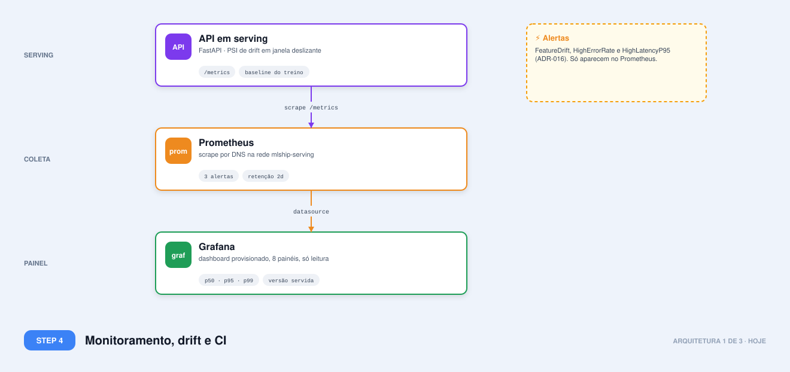

**Fluxo.** `validate` e `train` leem o projeto sem executá-lo. O `train` resolve o lock, constrói
(ou reaproveita) a imagem de ambiente, executa o runner no container isolado e, ao final, o
**host** recalcula os hashes de `/output` e só então registra no MLflow. O `promote` move o alias
`champion`. O `serve` resolve o alias, verifica o hash do modelo, constrói a imagem de serving
sobre a imagem de ambiente e sobe a API; ao subir, junta o container à rede `mlship-serving`,
onde só o Prometheus entra.

### Mapeamento do §6 do desafio, visão 1

| Tema | Como está hoje |
| --- | --- |
| Código | Git; hash do `train.py` e do lock no manifesto (ADR-015) |
| Dados | Diretório local; hash de conteúdo por arquivo no manifesto (ADR-014) |
| Artefatos | Volume do MLflow; hash verificado antes de qualquer `load` (ADR-020) |
| Métricas | Parâmetros e métricas no MLflow; métricas operacionais no Prometheus |
| Treino | Container isolado, uma execução por comando (ADR-018) |
| Inferência online | FastAPI, modelo carregado uma vez, predição fora do event loop (ADR-020) |
| Inferência em lote | Endpoint de lote vetorizado; job de lote separado é desenho |
| Registry | MLflow Registry, alias explícito `champion` (ADR-019) |
| Feature store | Não implementada; só desenho |
| CI/CD | GitHub Actions até o e2e; sem deploy (não há ambiente) |
| Observabilidade e drift | Prometheus, Grafana, PSI por feature, 3 alertas (ADR-016) |
| IAM e rede | Rede `none` no treino; rede dedicada para o scrape; API key opcional (ADR-020) |
| Custo | Roda em uma máquina; limites de CPU e memória por container |
| Cientista | CLI de seis comandos, erros coletados de uma vez, OpenAPI em `/docs` |

### Limites conhecidos desta visão

- Docker comum compartilha o kernel do host: o isolamento é de container, não de máquina virtual (ADR-018).
- Um único host, sem alta disponibilidade, sem autoscaling, sem controle de acesso entre usuários.
- O painel de operação cobre só a rota `/v1/predict` (não o lote) e não mostra saturação nem orçamento de erro (ADR-016).
- O gate de promoção usa métricas calculadas pelo próprio código do cientista (ADR-013).
- Os dados não são copiados: se o diretório mudar, o hash muda, mas o conteúdo antigo se perde (ADR-014).

---

## 2. Com mais tempo

O que muda em relação à visão 1 tem borda tracejada e a etiqueta `NOVO`. A ideia é a mesma ferramenta, mais robusta, ainda em
uma máquina ou em um servidor de CI, sem depender da AWS.

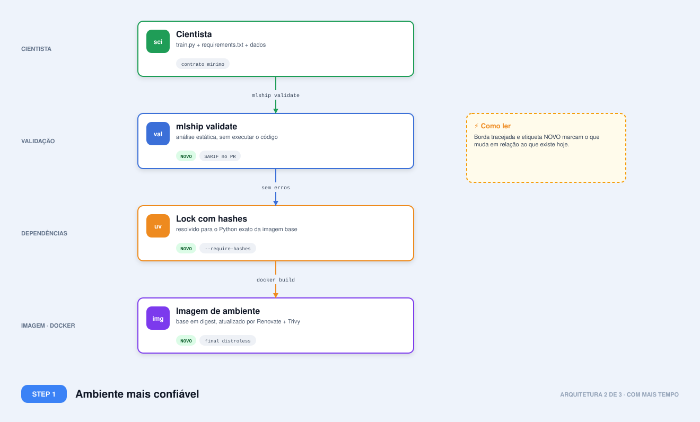

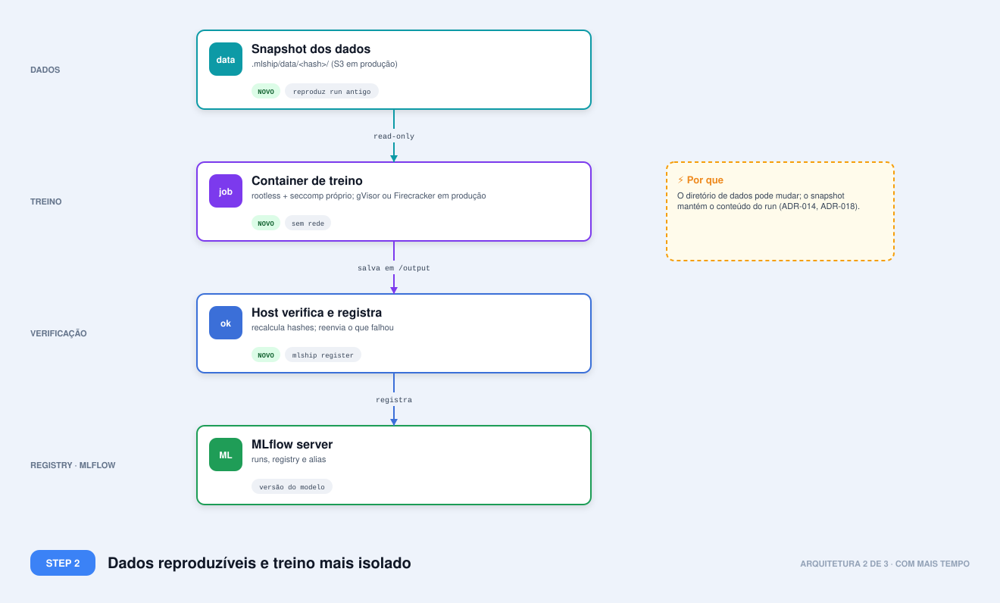

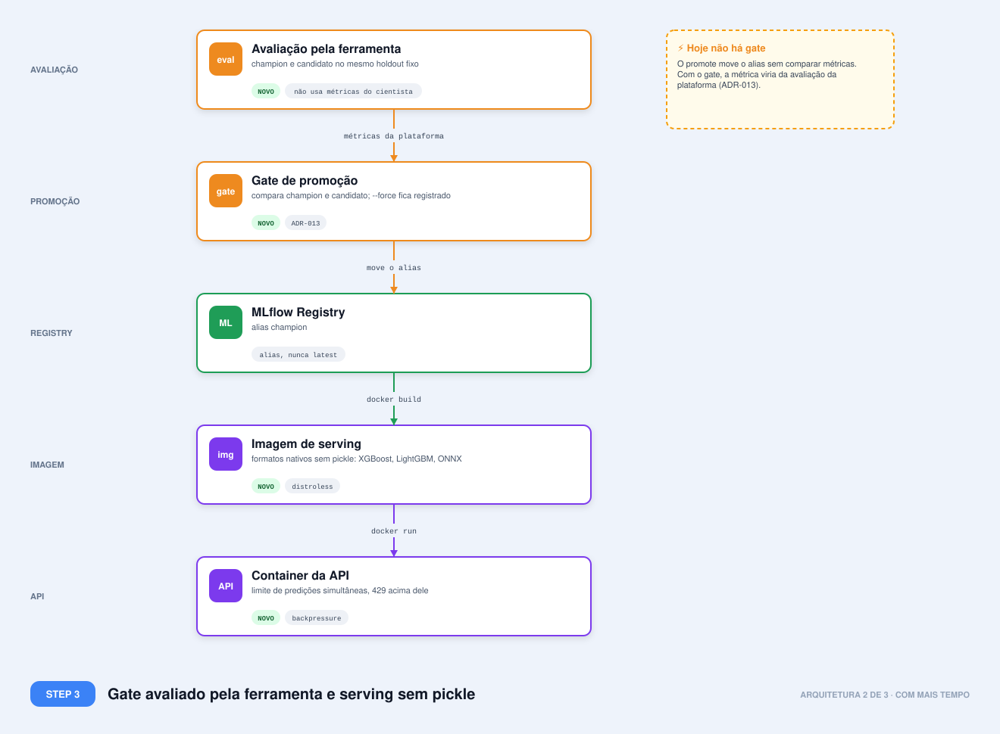

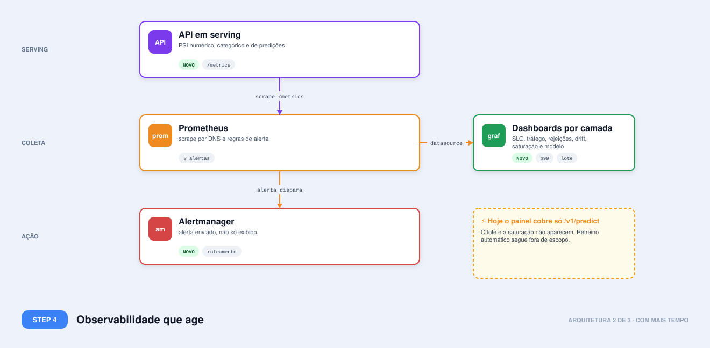

### O que cada mudança resolve

| Item novo | Problema da visão 1 | ADR |
| --- | --- | --- |
| Snapshot dos dados por conteúdo | Run antigo não reproduz se o diretório mudou | 014 |
| Formatos nativos sem pickle | Pickle executa código ao carregar, mesmo com hash conferido | 017 |
| Rootless, seccomp, gVisor ou Firecracker | Container compartilha o kernel do host | 018 |
| Imagem final distroless | Superfície de CVE e de shell dentro do serving | 005 |
| Atualização automática do digest base | Digest fixo envelhece e acumula CVE | 005 |
| Lock para o Python exato da imagem | Resolução em um Python, execução em outro | 005 |
| `mlship register <run>` | Upload que falhou no meio deixa o run só no disco | 019 |
| Limite de predições simultâneas + 429 | Sem backpressure, a latência explode sob pico | 020 |
| Drift categórico e de predição, Alertmanager | Hoje só numéricas, e o alerta apenas aparece no Prometheus | 016 |
| Dashboards por camada (SLO, rotas, rejeições, saturação, drift, modelo) | Painel atual tem 8 painéis e cobre só `/v1/predict`: o lote, a saturação e o orçamento de erro não aparecem | 016 |
| Saída SARIF no `validate` | Problemas não aparecem anotados no PR | 021 |
| Avaliação em holdout fixo pela ferramenta | O gate confia em métricas do código do cientista | 013 |

### Ordem sugerida, se houvesse mais tempo

1. Avaliação em holdout e gate (fecha a maior lacuna de governança).
2. Snapshot de dados (fecha a lacuna de reprodutibilidade).
3. Backpressure, Alertmanager e dashboards por camada (operação).
4. Formatos nativos e distroless (superfície de ataque).
5. gVisor e rootless (isolamento).

---

## 3. Produção na AWS

Estratégia **AWS First**, preferindo serviços gerenciados. Cada componente local tem um par explícito.

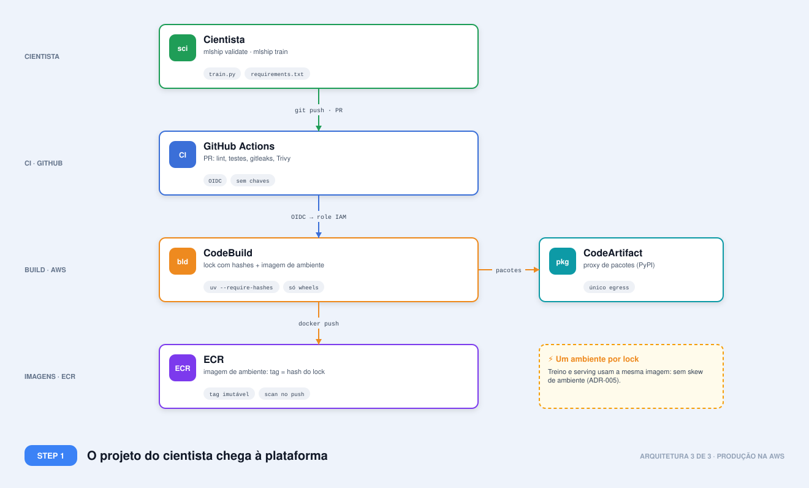

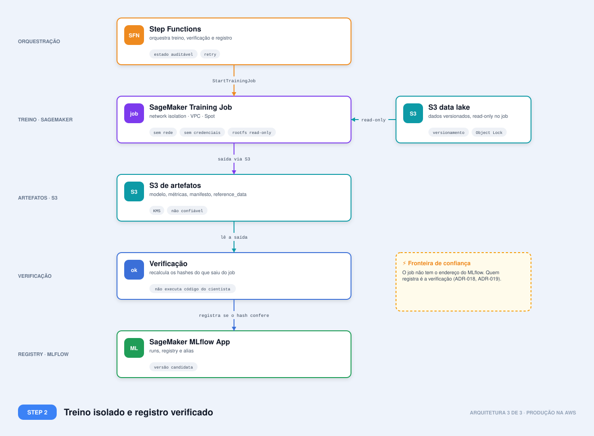

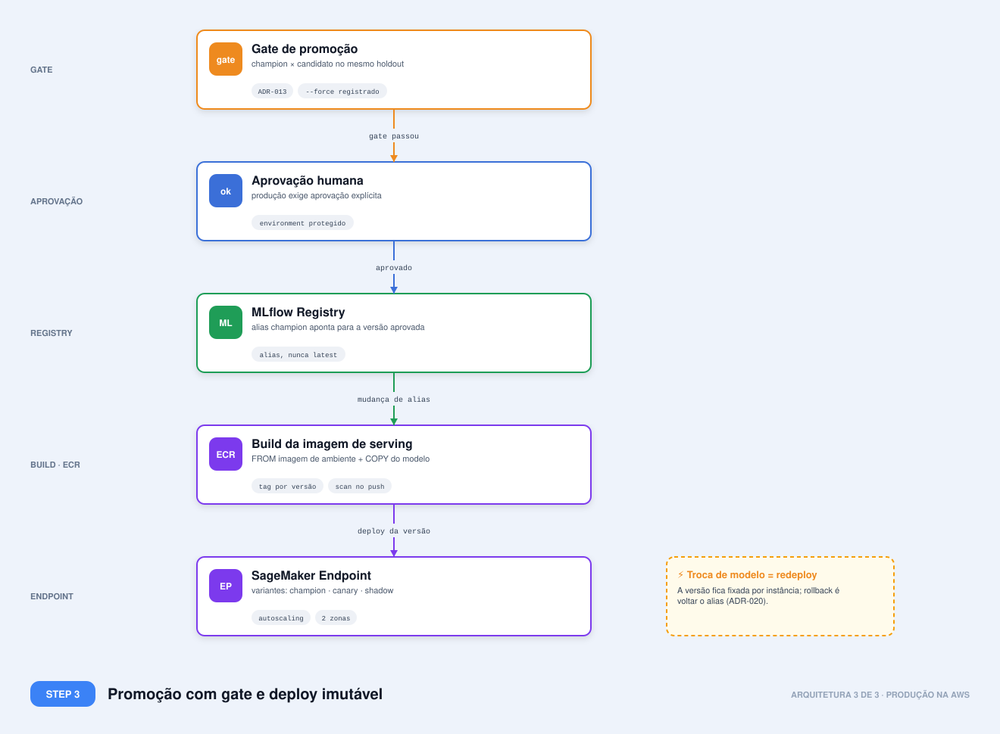

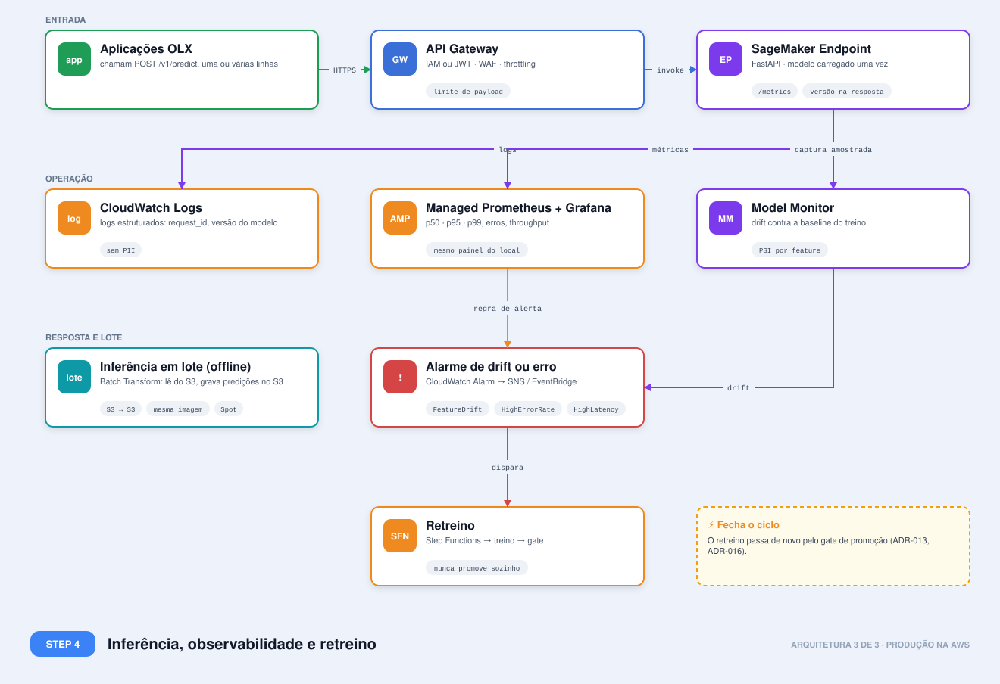

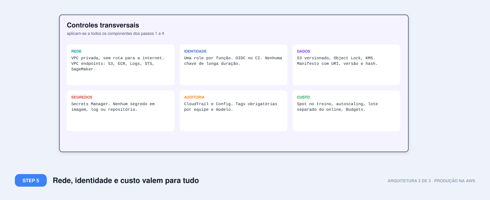

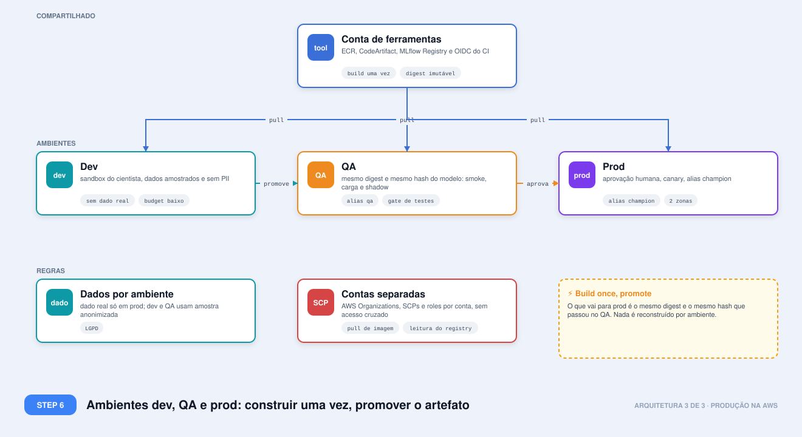

### Ambientes: dev, QA e prod

O desenho usa **uma conta AWS por ambiente** (nomes ilustrativos) mais uma conta de ferramentas, com o princípio
**construir uma vez e promover o artefato**: o que chega à produção é o mesmo digest de imagem e o mesmo hash de
modelo que passou no QA. A promoção move aliases no registry (`qa`, depois `champion`); nada é retreinado ou
reconstruído por ambiente. Produção exige aprovação humana. Dado real fica só em prod; dev e QA usam amostra
anonimizada.

### Fluxo de ponta a ponta

1. **Código.** O cientista abre um PR. O GitHub Actions roda lint, testes, gitleaks e Trivy; o CodeBuild resolve o lock com hashes **passando pelo CodeArtifact**, que é o único caminho de saída para pacotes, e publica a imagem de ambiente no ECR com tag imutável.
2. **Treino.** O Step Functions dispara um SageMaker Training Job na VPC com isolamento de rede. O job lê dados do S3 e escreve só a saída. O job **não tem** URI do MLflow nem credenciais do registry: é a mesma fronteira de confiança do ADR-018.
3. **Registro.** Uma etapa fora do job recalcula os hashes do que saiu e só então registra no MLflow. O modelo de um job com falha de verificação nunca chega ao registry.
4. **Promoção.** O gate (ADR-013) compara champion e candidato em holdout fixo. Se passar, o alias `champion` muda.
5. **Deploy.** A mudança de alias dispara o pipeline que constrói a imagem de serving (`FROM` a imagem de ambiente + modelo), publica no ECR e atualiza o endpoint. Canary e shadow são variantes do mesmo endpoint, com pesos.
6. **Operação.** Logs e métricas vão ao CloudWatch e ao Prometheus gerenciado. O Model Monitor compara a captura amostrada com a baseline gerada no treino. Alarme de drift abre o fluxo de retreino, que **passa de novo pelo gate**: nunca promove sozinho.

### Par AWS de cada componente local

| Local | Produção | Observação |
| --- | --- | --- |
| CLI `mlship` | Mesma CLI, apontando para o Step Functions e o MLflow da conta | O cientista não muda de fluxo |
| Docker daemon, container de treino | SageMaker Training Job com network isolation, em VPC | Mesmas restrições: sem rede, sem credenciais, saída só em S3 |
| Imagem de ambiente, imagem de serving | ECR com tags imutáveis e scan | Tag = hash do lock; digest registrado no manifesto |
| `uv` + PyPI | `uv` + CodeArtifact como proxy | Egress só para o proxy, sem internet |
| MLflow + SQLite + volume | SageMaker MLflow App (serverless) + S3 com KMS | Ver nota abaixo |
| Registry com alias `champion` | MLflow Registry; espelho opcional no SageMaker Model Registry | Alias continua sendo o contrato de consumo |
| Diretório de dados com hash | S3 com versionamento + manifesto com URI, versão e hash | ADR-014; Delta ou Iceberg se precisar de time travel |
| `serve` (container FastAPI) | SageMaker Endpoint com a mesma imagem | Ver decisão E8-3 |
| `/v1/predict/batch` (online, várias linhas por requisição) | O mesmo endpoint; a inferência em lote offline é um job separado: Batch Transform ou Processing Job | Mesmo modelo e mesma imagem, outro perfil de custo; só no desenho |
| Prometheus + Grafana | Managed Prometheus + Managed Grafana, além do CloudWatch | Mesmos painéis e alertas, versionados |
| PSI em janela na API | Model Monitor para o drift em lote e PSI online para o alerta rápido | Ver decisão E8-5 |
| Alertas (regras) | CloudWatch Alarms + SNS + EventBridge | Alarme aciona o Step Functions |
| API key opcional | IAM (serviço a serviço) ou JWT no API Gateway; WAF; segredos no Secrets Manager | ADR-020 |
| `compose.yaml` | Terraform ou CDK no repositório | Toda infraestrutura versionada |
| GitHub Actions | GitHub Actions com OIDC para roles IAM | Sem chaves de longa duração |
| Feature store (só desenho) | SageMaker Feature Store, offline em S3 e online | Ver decisão E8-6 |

## Referências

- [DECISIONS.md](../../DECISIONS.md): ADR-005, 007, 013, 014, 016, 017, 018, 019, 020
- [README.md](../../README.md): quickstart e resultados de carga
